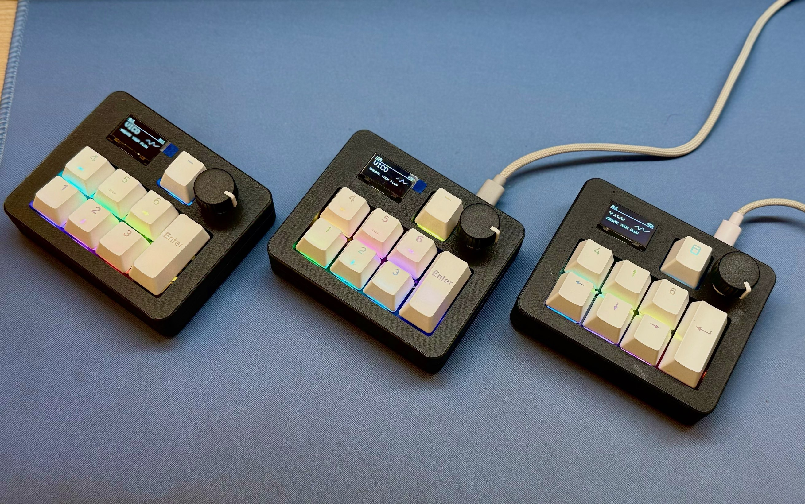

<div align="center">

<h1>Vico Keyboard Firmware</h1>

<p>面向 Vibe Coding、快捷操作与桌面效率场景的 ESP32-S3 可编程机械小键盘固件</p>

<p>
  
  
  
  
</p>

<p>
  <a href="#主要功能">主要功能</a> ·
  <a href="#硬件">硬件配置</a> ·
  <a href="#引脚定义">引脚定义</a> ·
  <a href="#构建与烧录">构建与烧录</a> ·
  <a href="https://github.com/Apezer/vico-deck">VicoDeck 配套软件</a> ·
  <a href="http://vico.zheng2005.xyz/">官方网站</a>
</p>

</div>

> 当前正式版本：**1.0.2**

Vico Keyboard 是一款基于 DFRobot FireBeetle 2 ESP32-S3 的 8 键可编程机械小键盘。
它同时支持 USB HID 与 BLE HID，可驱动 128×64 OLED、8 颗 WS2812B、EC11 旋钮、
INMP441 数字麦克风和电池电量检测，并通过专用数据通道与
[VicoDeck 配套软件](https://github.com/Apezer/vico-deck)双向同步按键预设、OLED、RGB、
设备状态和语音数据。

## 实物展示

<p align="center">
  
</p>

<p align="center"><sub>多台 Vico Keyboard 成品：不同键帽配置、OLED 页面与 RGB 灯效</sub></p>

<p align="center">
  
</p>

<p align="center"><sub>正面细节：128×64 OLED、八个机械按键、EC11 旋钮和轴下 RGB</sub></p>

## 主要功能

- USB/BLE 双模式 HID 键盘，拨动 GPIO38 开关即可热切换，无需重启。
- BLE 模式空闲 10 分钟后关闭 OLED/RGB 并进入保持 GATT 的连接空闲态，累计空闲 20 分钟后进入深度睡眠；USB 模式不休眠。
- 8 个按键、5 套可编辑预设，按键映射和当前预设保存在 NVS 中。
- EC11 顺时针调高音量、逆时针调低音量。
- 按住 EC11 开始录音，松开后结束录音并交给配套软件进行云端语音识别。
- OLED 支持品牌、Coding、性能、时钟、键盘状态和自定义像素画等页面。
- OLED 数字孪生可将屏幕实际帧缓冲同步到配套软件，而不是重新模拟界面。
- 8 颗 WS2812B 支持关闭、常亮、呼吸、七彩等模式，并可从配套软件或板载菜单配置。
- GPIO14 监测单节锂电池电压；电量可同步到 BLE Battery Service 和配套软件。
- USB Vendor HID 与自定义 BLE GATT 共用统一的数据协议，用于配置、状态、
  OLED 图像和语音数据传输。

## 硬件

| 部件 | 型号或说明 |
| --- | --- |
| 主控 | DFRobot FireBeetle 2 ESP32-S3 |
| OLED | SSD1306，128×64，I2C |
| 按键 | 8 个按键，按下接 GND，使用内部上拉 |
| 模式开关 | SPDT 拨片开关 |
| RGB | 8 颗 WS2812B |
| 旋钮 | EC11 增量式编码器，带按压开关 |
| 麦克风 | INMP441，I2S 数字麦克风 |
| 电池检测 | 100K/100K 分压和 100nF 滤波电容 |

## 引脚定义

| 功能 | GPIO | 说明 |
| --- | ---: | --- |
| OLED SDA | 10 | I2C 数据 |
| OLED SCL | 9 | I2C 时钟 |
| KEY1 | 18 | 默认：左方向键 |
| KEY2 | 17 | 默认：下方向键 |
| KEY3 | 16 | 默认：右方向键 |
| KEY4 | 15 | 默认：Enter |
| KEY5 | 5 | 默认：Backspace |
| KEY6 | 6 | 默认：上方向键 |
| KEY7 | 7 | 默认：Ctrl + Win |
| KEY8 | 4 | Fn，固件内部功能键 |
| WS2812B DIN | 8 | RGB 灯带数据 |
| EC11 A | 11 | 旋钮 A 相 |
| EC11 B | 12 | 旋钮 B 相 |
| EC11 SW | 13 | 旋钮按键，按下接 GND |
| INMP441 SD | 39 | I2S 数据输入 |
| INMP441 SCK | 40 | I2S 位时钟 |
| INMP441 WS | 41 | I2S 左右声道时钟 |
| 模式选择 | 38 | GND 为 BLE，3.3V 为 USB |
| 电池 ADC | 14 | 100K/100K 分压中点 |

INMP441 的 `L/R` 接 GND，电源和逻辑电平使用 3.3V。EC11 公共端 C、开关另一端
和外壳固定脚接 GND。

### USB/BLE 模式开关

拨片公共端连接 GPIO38，另外两端分别连接 GND 和 3.3V：

- GPIO38 接 GND：BLE 模式。
- GPIO38 接 3.3V：USB 模式。

固件持续监测拨片状态，电平稳定 50 ms 后自动切换。切换时会先释放当前接口的
全部 HID 按键，再关闭旧接口并启动新接口，避免出现按键卡住。请使用 SPDT
拨片开关，避免直接短接 3.3V 与 GND。

### 低功耗与唤醒

低功耗只在 BLE 电池模式启用。连续 10 分钟没有按键、旋钮或明确的软件设置操作后，
固件会释放 HID 状态并关闭 OLED 与 RGB，但继续运行 BLE HID 和自定义 GATT 服务。
这一阶段不调用显式 Light-sleep，因此电脑与配套软件的蓝牙连接不会被固件主动断开；
按键、旋钮、模式拨片或软件设置操作都可以立即恢复 OLED 与用户保存的 RGB 灯效。

如果连接空闲态继续保持 10 分钟没有操作，设备会在累计空闲 20 分钟时进入深度睡眠。
深度睡眠可由 KEY1～KEY8 或旋钮按压唤醒。GPIO38 不属于 ESP32-S3 的深睡 RTC
唤醒引脚，因此深睡后只拨动模式开关不会立即唤醒；请再按一次任意按键，设备启动后
会读取 GPIO38 并进入所选模式。USB 模式由外部供电，固件不会进入连接空闲态或深度睡眠。

## 默认按键和快捷操作

| 操作 | 功能 |
| --- | --- |
| KEY1～KEY8 | 左、下、右、Enter、Backspace、上、Ctrl+Win、Fn |
| Fn + KEY1～KEY5 | 切换 P1～P5 预设，组合键不会发送给电脑 |
| Fn + KEY6 / KEY7 | 向前/向后切换 OLED 页面 |
| KEY4 + KEY8 | 打开板载设置菜单 |
| EC11 顺时针/逆时针 | 音量加/音量减 |
| 按住 EC11 | 开始语音录音 |
| 松开 EC11 | 停止录音并等待剩余音频发送完毕 |

物理按键使用 10 ms 去抖。EC11 使用 A/B 相 CHANGE 中断记录正交状态，一个完整
四相周期产生一次音量动作；按压开关连续稳定 25 ms 后才会开始语音会话。实际装配
后如果旋转方向相反，可把 `src/rotary_encoder.h` 中的 `DIRECTION` 改为 `-1`。

## USB 与蓝牙通信

### USB 模式

- USB 产品名：`Vico Keyboard`。
- 当前板级 VID/PID：`3343:83CF`。
- 标准键盘/Consumer HID 负责按键和媒体控制。
- Vendor Report ID 6 负责配套软件的配置、OLED、RGB、状态和语音数据。
- TinyUSB 会检测主机是否完成枚举；未连接时 OLED 显示 `PLUG IN USB` 动画。

### BLE 模式

- 蓝牙设备名：`Vico Keyboard`。
- BLE HID 负责键盘和媒体控制。
- BLE Battery Service 上报当前估算电量。
- 自定义 GATT 服务负责配套软件配置、状态、OLED 图像和语音数据。
- HID 已连接后固件仍保持可发现能力，使配套软件能够建立自定义 GATT 连接。

## 语音输入流程

语音识别不是在 ESP32-S3 上运行。固件只负责采集和传输，配套软件负责组装音频、
调用用户配置的云端语音识别 API，并把识别结果输入到当前文本框。

1. 配套软件先通过 USB Vendor HID 或 BLE GATT 完成语音能力握手。
2. 用户按住 EC11，固件确认传输端已就绪后启动 INMP441。
3. 麦克风以 16 kHz、16 bit、单声道 PCM 格式持续采样。
4. 固件边采样边发送；USB 使用 32 KB 内部 RAM 环形缓冲，BLE 使用 512 KB
   PSRAM 环形缓冲，以承受蓝牙吞吐量较低时产生的积压。
5. 用户松开 EC11 后停止采样，固件继续排空缓冲区并发送会话结束标记。
6. 配套软件收到完整音频后调用云端模型并输出识别文本。

录音、排空和错误提示期间，语音任务具有最高优先级。固件会释放并暂停普通 HID
按键，同时暂停 OLED 常规刷新、RGB、预设和电池等后台同步，把当前 USB/BLE
数据通道优先留给音频；传输完成或异常超时后自动恢复。I2S DMA 与 USB 队列保留在
内部 RAM，BLE 语音队列在首次录音时从 PSRAM 分配并持续复用。

如果未运行配套软件、自定义数据通道未连接或语音握手尚未完成，按下旋钮不会开始
有效录音，OLED 会显示相应的传输错误状态。

## OLED

固件提供以下运行时页面：

- 品牌页面。
- Claude Code/Coding 状态。
- CPU、GPU 等电脑性能信息。
- 时间与日期。
- 键盘、连接与按键状态。
- 自定义 128×64 单色像素画。

页面内容可以通过 USB Vendor HID 或 BLE GATT 更新。自定义像素画以分片方式传输，
完整数据通过 CRC32 校验后才会显示；用户在软件中执行“保存到键盘”后，图像会写入
独立 NVS 缓存，软件断开或键盘重启后仍可显示。

数字孪生功能按需回传 SSD1306 的 1024 字节真实帧缓冲并附带 CRC32。软件看到的
内容与物理 OLED 使用同一份像素数据，不会占用按键扫描的实时路径。

## 板载设置菜单

| 操作 | 功能 |
| --- | --- |
| KEY4 + KEY8 | 进入设置 |
| KEY6 | 向上 |
| KEY2 | 向下 |
| KEY4 | 确认 |
| KEY5 | 返回 |
| KEY8 | 退出设置 |

菜单包含 `PROFILE`、`OLED`、`RGB LIGHT`、`CONNECTION`、`KEY TEST`、
`DEVICE INFO`、`FACTORY RESET` 和 `EXIT`。菜单操作不会发送 HID 按键。
USB/BLE 模式始终由 GPIO38 硬件拨片决定，菜单只能查看连接状态，不能覆盖拨片。

## 电池监测与校准

采样电路应连接为：

```text
VBAT -> 100K -> GPIO14 -> 100K -> GND
                    |
                  100nF
                    |
                   GND
```

固件每 250 ms 采样一次，对 4 次 ADC 读数取平均后进行指数平滑，再按单节锂电池
分段放电曲线换算为 0～100%。标称关系为：

```text
VBAT(mV) = analogReadMilliVolts(GPIO14) × 2
```

ESP32-S3 ADC 和分压电阻都有误差。首次装机建议用万用表同时测量电池实际电压；
如果 OLED 与万用表不一致，可调整 `src/battery_monitor.cpp` 中的
`CALIBRATION_PERMILLE`：

```text
新校准值 = 当前校准值 × 万用表电压 / OLED 显示电压
```

例如万用表为 4000 mV、OLED 为 3920 mV，可将 `1000` 调整为约 `1020`。
当前硬件只能测量电压并估算剩余电量，无法可靠判断是否正在充电；如需充电状态，
应额外连接充电管理芯片的状态引脚。

## 配置持久化

以下内容会保存到 ESP32 NVS，断电后保留：

- 五套按键预设及当前预设。
- OLED 默认页面、亮度、休眠和 Claude 自动覆盖设置。
- RGB 模式、颜色、亮度、速度和总开关。
- 已明确保存到键盘的自定义像素画。

按键预设采用固定 5 字节按键定义、逐命令确认和 CRC32 原子提交，避免同步中断后
留下半套配置。

## 开发环境

- [PlatformIO](https://platformio.org/)
- Arduino Framework for ESP32
- C++17

`platformio.ini` 声明的主要依赖：

- [Adafruit SSD1306](https://github.com/adafruit/Adafruit_SSD1306) `^2.5.7`
- [Adafruit GFX Library](https://github.com/adafruit/Adafruit-GFX-Library) `^1.11.5`
- [NimBLE-Arduino](https://github.com/h2zero/NimBLE-Arduino) `^2.1.0`
- [ESP32 NIMBLE Keyboard](https://github.com/Berg0162/ESP32-NIMBLE-Keyboard)
  `v2.0.1`，已放在 `lib/ESP32-NIMBLE-Keyboard`

项目使用 NimBLE 以降低 BLE 的 RAM 和 Flash 占用。本地已经包含修改过的键盘库，
因此 PlatformIO 不会再从 GitHub 下载另一份 BLE Keyboard 实现。

## 构建与烧录

克隆项目：

```bash
git clone git@github.com:Apezer/ESP32S3-Vico-Keyboard.git
cd ESP32S3-Vico-Keyboard
```

编译：

```bash
pio run
```

连接开发板后烧录：

```bash
pio run --target upload
```

如电脑连接了多个串口，可在 `platformio.ini` 中设置 `upload_port`，或在命令行指定：

```bash
pio run --target upload --upload-port COMx
```

## 项目结构

```text
├── platformio.ini             # PlatformIO 环境、依赖与 USB 编译参数
├── src/
│   ├── main.cpp               # 主循环、模式切换、HID、菜单和 OLED 绘制
│   ├── key_profiles.*         # 五套按键预设、CRC32 提交与 NVS
│   ├── device_settings.*      # OLED/RGB 设置及 NVS
│   ├── battery_monitor.*      # GPIO14 采样、滤波、电压和电量换算
│   ├── rotary_encoder.*       # EC11 正交解码和按键去抖
│   ├── voice_capture.*        # INMP441 I2S 采集、环形缓冲和语音会话
│   ├── oled_runtime.*         # 配套软件状态、页面数据和 BLE GATT 协议
│   ├── oled_twin.*            # USB Vendor HID、数字孪生和分片传输
│   ├── rbg_led.*              # WS2812B 灯效及设置应用
│   ├── font.h
│   └── font.c                 # OLED 字模和 Claude 图标数据
└── lib/
    ├── ESP32-NIMBLE-Keyboard/ # 本地 BLE HID 键盘库
    └── FastLED_min/           # 精简 WS2812B 驱动
```

## 相关项目

- 官方网站：[Vico Keyboard](http://vico.zheng2005.xyz/)
- 固件仓库：[Apezer/ESP32S3-Vico-Keyboard](https://github.com/Apezer/ESP32S3-Vico-Keyboard)
- 配套软件：[Apezer/vico-deck](https://github.com/Apezer/vico-deck)
